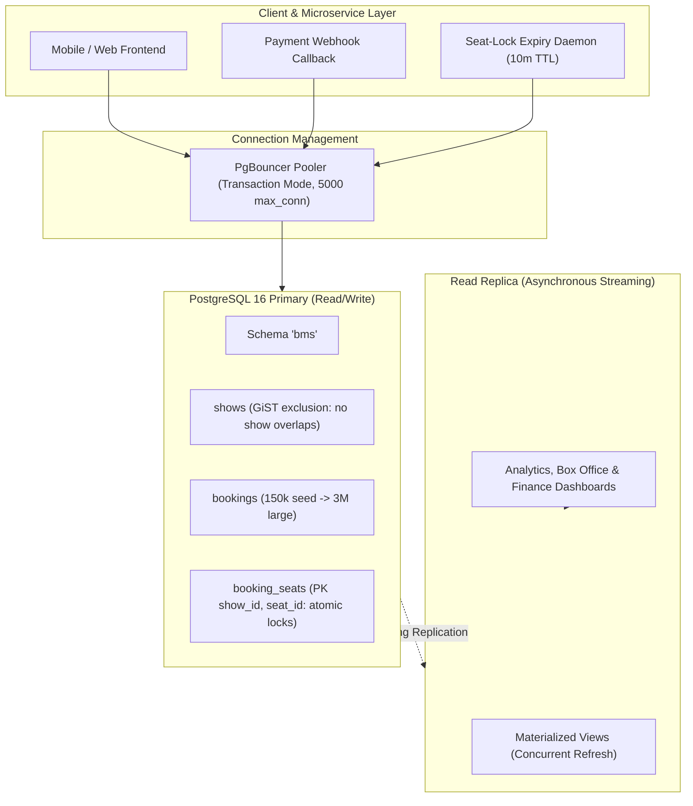
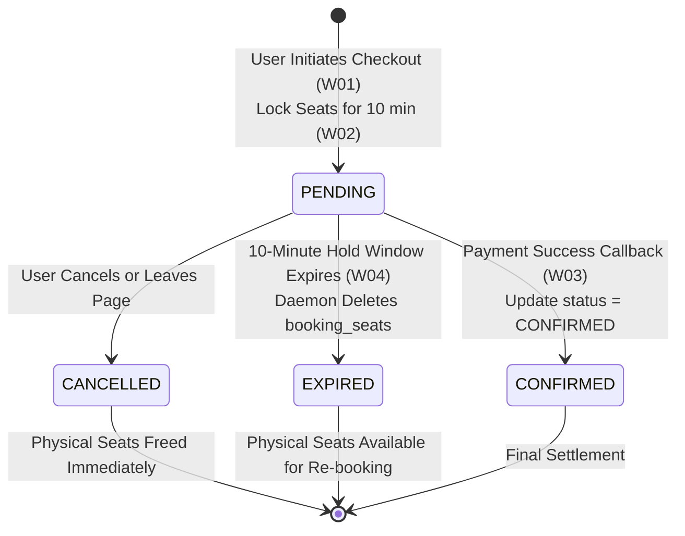

# BookMyShow Database Architecture & Engineering Overview

**Course:** Database Management Systems (B.Tech 2nd Year)  
**Team:** T0132 · **Section:** E and D  
**Lead:** Piyush Alagh · **Engineers:** Kushal Garg, Aujasya Rajput, Aryan Damara  
**Platform Target:** PostgreSQL 16+ on Apple M4 / Ubuntu Enterprise  

---

## 1. System Architecture & Topology

The BookMyShow Ticketing Engine is engineered to handle millions of seat reservations with strict concurrency guarantees, zero double-booking, and sub-millisecond response times.

---

## 2. Transaction Lifecycle & Seat Locking State Machine

### Concurrency Protection Rules:
1. **Atomic Lock Exclusivity:** `PRIMARY KEY (show_id, seat_id)` on `booking_seats` ensures two transactions can NEVER hold the same seat for a show. If a collision occurs, PostgreSQL immediately rejects the second transaction with a unique violation.
2. **Non-Blocking Checkout:** Workload query `W02` uses `ON CONFLICT (show_id, seat_id) DO NOTHING`, ensuring graceful degradation without application crashes.
3. **Show Overlap Prevention:** `EXCLUDE USING gist (screen_id WITH =, tstzrange(starts_at, ends_at) WITH &&)` physically guarantees that no screen can be scheduled with overlapping showtimes.

---

## 3. Four-Layer Optimization Framework

| Layer | Implementation Artifact | Key Impact |
|---|---|---|
| **Layer 1: Relational Schema & Types** | [`sql/01_schema.sql`](../sql/01_schema.sql) | Sized integer types (`SMALLINT` for durations/ratings), exact currency precision (`NUMERIC(10,2)`), 16+ business domain CHECK constraints, temporal exclusion constraint. |
| **Layer 2: Production Indexing** | [`sql/05_indexes.sql`](../sql/05_indexes.sql) | Composite indexes, covering indexes with `INCLUDE`, partial indexes (`WHERE status = 'PENDING'`), and GIN trigram text search. |
| **Layer 3: Query Rewrites** | [`sql/06_optimized_queries.sql`](../sql/06_optimized_queries.sql) | Sargable date range predicates, antijoins fixing SQL Three-Valued Logic (`NOT EXISTS`), and $O(1)$ Keyset Pagination replacing $O(N)$ `OFFSET`. |
| **Layer 4: Partitioning & Scaling** | [`sql/08_partitioning.sql`](../sql/08_partitioning.sql) | Monthly RANGE partitioning on `shows` and `bookings`, HASH partitioning on `booking_seats`, partition pruning, and materialized views. |

---

## 4. Documentation & Artifact Navigation Index

| Milestone | Deliverable Document | Core Artifacts & Scripts |
|---|---|---|
| **CP1: Problem Understanding & Schema** | [`docs/01_problem_understanding.md`](01_problem_understanding.md) [`docs/02_schema_design.md`](02_schema_design.md) | [`sql/01_schema.sql`](../sql/01_schema.sql) [`sql/02_load_data.sql`](../sql/02_load_data.sql) [`diagrams/er_diagram.svg`](../diagrams/er_diagram.svg) |
| **CP2: Baseline Benchmarks** | [`docs/03_baseline_timings.md`](03_baseline_timings.md) | [`benchmarks/results/baseline/summary.csv`](../benchmarks/results/baseline/summary.csv) [`benchmarks/run_benchmark.sh`](../benchmarks/run_benchmark.sh) |
| **CP3: Code Optimization** | [`docs/04_optimization_report.md`](04_optimization_report.md) | [`sql/05_indexes.sql`](../sql/05_indexes.sql) [`sql/06_optimized_queries.sql`](../sql/06_optimized_queries.sql) [`benchmarks/results/optimized/summary.csv`](../benchmarks/results/optimized/summary.csv) |
| **CP4: Scalability & Partitioning** | [`docs/05_scalability_report.md`](05_scalability_report.md) | [`sql/08_partitioning.sql`](../sql/08_partitioning.sql) [`benchmarks/results/large/summary.csv`](../benchmarks/results/large/summary.csv) |
| **CP5: Individual Viva Defense** | [`docs/06_individual_analysis_prep.md`](06_individual_analysis_prep.md) | Complete oral examination prep card, cost analysis, and plan walkthroughs. |
| **Production Runbooks** | [`docs/runbooks/`](runbooks/) | Disaster Recovery, Zero-Downtime Deployments, and DBA diagnostics. |
