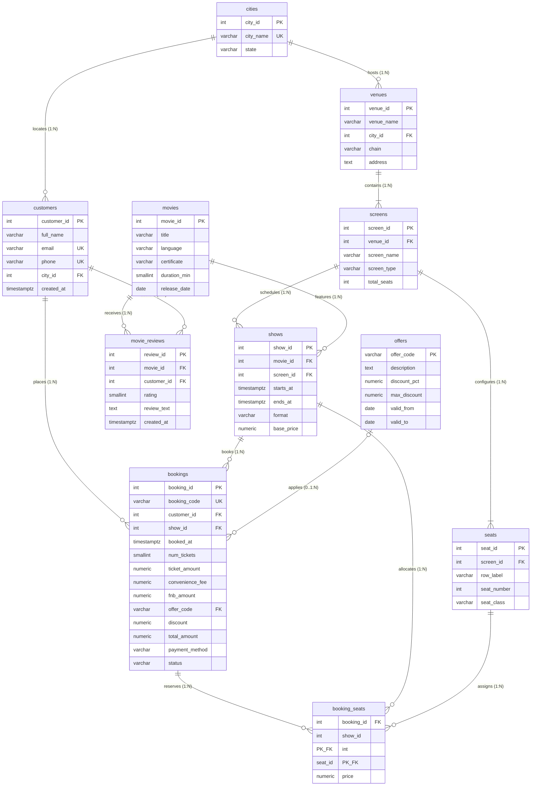

# Phase 2: Relational Schema Design & Relational Verification

**Course:** Database Management Systems · **Team:** T0132 · **Section:** E and D  
**Repository:** [EdgeRunner-runit/DE_Project_2026](https://github.com/EdgeRunner-runit/DE_Project_2026)  
**Database Target:** PostgreSQL 15+ (Production Target: PostgreSQL 16/18)

---

## 1. Executive Summary & Design Principles

The objective of Phase 2 is to reverse-engineer a robust, production-grade relational database schema from the BookMyShow production CSV seed exports (11 files, 300k+ booking seats, 160k shows, 150k bookings).

### Core Architectural Decisions:
1. **Strict Namespace Isolation:** All database objects reside in dedicated schema `bms`.
2. **Phase 2 Baseline Rule:** Only declarative integrity constraints (`PRIMARY KEY`, `FOREIGN KEY`, `NOT NULL`, `UNIQUE`, `CHECK`, `EXCLUDE`) are established. Secondary indexes (B-Tree, GIN, Hash) are strictly deferred to Phase 4 to maintain an authentic baseline for Phase 3 query benchmarking.
3. **Concurrency-Safe Seat Locking:** Concurrency conflicts (e.g. race conditions where two users attempt to grab the same seat) are prevented at the relational storage layer using a composite primary key on `booking_seats (show_id, seat_id)`.
4. **Temporal Non-Overlap Guarantee:** Show collisions on auditoriums are physically barred using PostgreSQL's generalized search tree (`btree_gist`) exclusion constraint.

---

## 2. Complete Data Dictionary

### 2.1 Table: `bms.cities`
Represents the municipal territories where BookMyShow operates partner cinema venues.

| Column | Type | Constraints | Justification & Domain Semantics |
|---|---|---|---|
| `city_id` | `INT` | `PRIMARY KEY` | Unique surrogate identifier for municipal territory. |
| `city_name` | `VARCHAR(100)` | `NOT NULL, UNIQUE, CHECK (length(trim(city_name)) > 0)` | City title (e.g., Bengaluru, Mumbai). Unique candidate key prevents duplicate city listings. |
| `state` | `VARCHAR(100)` | `NOT NULL, CHECK (length(trim(state)) > 0)` | Province or state jurisdiction in India. |

### 2.2 Table: `bms.venues`
Represents physical cinema properties (multiplexes or single-screen theatres).

| Column | Type | Constraints | Justification & Domain Semantics |
|---|---|---|---|
| `venue_id` | `INT` | `PRIMARY KEY` | Unique identifier for cinema property. |
| `venue_name` | `VARCHAR(150)` | `NOT NULL, CHECK (length(trim(venue_name)) > 0)` | Commercial display name (e.g., "PVR Forum Mumbai"). |
| `city_id` | `INT` | `NOT NULL, FK -> cities(city_id) ON DELETE RESTRICT` | Geographic link. `RESTRICT` prevents deleting cities that house operational cinemas. |
| `chain` | `VARCHAR(50)` | `NOT NULL, CHECK (chain IN ('PVR', 'INOX', 'Cinepolis', 'Miraj', 'Independent'))` | Cinema operating brand. Strict domain restriction matching seed data. |
| `address` | `TEXT` | `NOT NULL` | Physical street address. |

### 2.3 Table: `bms.screens`
Represents individual auditoriums inside a cinema venue.

| Column | Type | Constraints | Justification & Domain Semantics |
|---|---|---|---|
| `screen_id` | `INT` | `PRIMARY KEY` | Unique identifier for screen auditorium. |
| `venue_id` | `INT` | `NOT NULL, FK -> venues(venue_id) ON DELETE CASCADE` | Enclosing cinema. `CASCADE` ensures deleting a cinema removes all its auditoriums. |
| `screen_name` | `VARCHAR(50)` | `NOT NULL` | Auditorium designation within venue (e.g. "Audi 1", "Screen 2"). |
| `screen_type` | `VARCHAR(20)` | `NOT NULL, CHECK (screen_type IN ('STANDARD', 'IMAX', '4DX', 'GOLD'))` | Auditorium hardware profile. |
| `total_seats` | `INT` | `NOT NULL, CHECK (total_seats > 0)` | Physical auditorium capacity. Redundant column kept for sub-millisecond layout checks. |

*Candidate Key Constraint:* `UNIQUE (venue_id, screen_name)` ensures auditorium names are unique per cinema.

### 2.4 Table: `bms.seats`
Represents the static physical seating layout of each auditorium.

| Column | Type | Constraints | Justification & Domain Semantics |
|---|---|---|---|
| `seat_id` | `INT` | `PRIMARY KEY` | Unique surrogate key for every physical chair in the platform. |
| `screen_id` | `INT` | `NOT NULL, FK -> screens(screen_id) ON DELETE CASCADE` | Auditorium reference. `CASCADE` cleans layout if screen is reconfigured/deleted. |
| `row_label` | `VARCHAR(2)` | `NOT NULL, CHECK (row_label ~ '^[A-Z]{1,2}$')` | Row lettering (e.g. 'A', 'B', 'P'). |
| `seat_number` | `INT` | `NOT NULL, CHECK (seat_number > 0)` | 1-based sequential seat index along the row. |
| `seat_class` | `VARCHAR(20)` | `NOT NULL, CHECK (seat_class IN ('CLASSIC', 'PRIME', 'RECLINER'))` | Seating tier used for tier-based differential ticket pricing. |

*Candidate Key Constraint:* `UNIQUE (screen_id, row_label, seat_number)` guarantees no duplicate coordinate inside an auditorium.

### 2.5 Table: `bms.movies`
Represents the cinematic content catalogue.

| Column | Type | Constraints | Justification & Domain Semantics |
|---|---|---|---|
| `movie_id` | `INT` | `PRIMARY KEY` | Unique movie identifier. |
| `title` | `VARCHAR(255)` | `NOT NULL, CHECK (length(trim(title)) > 0)` | Official release title. |
| `language` | `VARCHAR(50)` | `NOT NULL, CHECK (language IN ('Hindi', 'English', 'Telugu', 'Tamil', 'Kannada', 'Malayalam', 'Marathi', 'Bengali'))` | Audio track language. |
| `certificate` | `VARCHAR(10)` | `NOT NULL, CHECK (certificate IN ('U', 'UA', 'A'))` | CBFC rating certification. |
| `duration_min` | `SMALLINT` | `NOT NULL, CHECK (duration_min BETWEEN 30 AND 360)` | Running time in minutes (`SMALLINT` saves 2 bytes/row over `INT`). |
| `release_date` | `DATE` | `NOT NULL` | Official commercial debut date. |

### 2.6 Table: `bms.shows`
Represents scheduled screenings of a movie on a screen at an exact date and time.

| Column | Type | Constraints | Justification & Domain Semantics |
|---|---|---|---|
| `show_id` | `INT` | `PRIMARY KEY` | Unique show identifier. |
| `movie_id` | `INT` | `NOT NULL, FK -> movies(movie_id) ON DELETE RESTRICT` | Screened content. `RESTRICT` prevents deleting movies with scheduled screenings. |
| `screen_id` | `INT` | `NOT NULL, FK -> screens(screen_id) ON DELETE RESTRICT` | Auditorium. `RESTRICT` prevents deleting screens during active schedules. |
| `starts_at` | `TIMESTAMPTZ` | `NOT NULL` | Scheduled curtain time with timezone offset (+05:30 IST). |
| `ends_at` | `TIMESTAMPTZ` | `NOT NULL` | Show conclusion time. Verified to include exact 15-minute turnaround buffer. |
| `format` | `VARCHAR(20)` | `NOT NULL, CHECK (format IN ('2D', '3D', 'IMAX', '4DX'))` | Projection format. |
| `base_price` | `NUMERIC(10, 2)` | `NOT NULL, CHECK (base_price > 0)` | Base ticket price before class modifiers or surge pricing. |

*Chronology Constraint:* `CHECK (ends_at > starts_at)`.  
*Temporal Exclusion Constraint:*  
`EXCLUDE USING gist (screen_id WITH =, tstzrange(starts_at, ends_at) WITH &&)` ensures zero auditorium double-booking.

### 2.7 Table: `bms.customers`
Represents registered users of the BookMyShow mobile and web applications.

| Column | Type | Constraints | Justification & Domain Semantics |
|---|---|---|---|
| `customer_id` | `INT` | `PRIMARY KEY` | Unique user account identifier. |
| `full_name` | `VARCHAR(150)` | `NOT NULL, CHECK (length(trim(full_name)) > 0)` | Customer legal name. |
| `email` | `VARCHAR(255)` | `NOT NULL, UNIQUE, CHECK (email ~* '^[A-Za-z0-9._%+-]+@[A-Za-z0-9.-]+\.[A-Za-z]{2,}$')` | Unique login email with RFC-5322 regex validation. |
| `phone` | `VARCHAR(15)` | `NOT NULL, UNIQUE, CHECK (phone ~ '^[0-9]{10}$')` | Unique Indian mobile contact number. |
| `city_id` | `INT` | `NOT NULL, FK -> cities(city_id) ON DELETE RESTRICT` | User primary residential city. |
| `created_at` | `TIMESTAMPTZ` | `NOT NULL` | Account registration timestamp. |

### 2.8 Table: `bms.offers`
Represents promotional coupon codes and partnership discount rules.

| Column | Type | Constraints | Justification & Domain Semantics |
|---|---|---|---|
| `offer_code` | `VARCHAR(50)` | `PRIMARY KEY` | Natural coupon key (e.g. `AMAZONPAY17`, `ICICI10`). |
| `description` | `TEXT` | `NOT NULL` | Marketing terms and promo details. |
| `discount_pct` | `NUMERIC(5, 2)` | `NOT NULL, CHECK (discount_pct BETWEEN 0 AND 100)` | Percentage markdown. |
| `max_discount` | `NUMERIC(10, 2)` | `NOT NULL, CHECK (max_discount >= 0)` | Maximum rupee discount cap. |
| `valid_from` | `DATE` | `NOT NULL` | Campaign launch date. |
| `valid_to` | `DATE` | `NOT NULL` | Campaign expiration date. `CHECK (valid_to >= valid_from)`. |

### 2.9 Table: `bms.bookings`
Represents financial checkout transactions.

| Column | Type | Constraints | Justification & Domain Semantics |
|---|---|---|---|
| `booking_id` | `INT` | `PRIMARY KEY` | Unique order transaction ID. |
| `booking_code` | `VARCHAR(20)` | `NOT NULL, UNIQUE, CHECK (booking_code ~ '^BMS[0-9A-F]{7}$')` | Alphanumeric confirmation code shown to user. |
| `customer_id` | `INT` | `NOT NULL, FK -> customers(customer_id) ON DELETE RESTRICT` | Buyer. `RESTRICT` prevents deleting customer ledger history. |
| `show_id` | `INT` | `NOT NULL, FK -> shows(show_id) ON DELETE RESTRICT` | Scheduled show reference. |
| `booked_at` | `TIMESTAMPTZ` | `NOT NULL` | Exact transaction initiation time. |
| `num_tickets` | `SMALLINT` | `NOT NULL, CHECK (num_tickets > 0)` | Quantity of tickets reserved in order. |
| `ticket_amount` | `NUMERIC(10, 2)` | `NOT NULL, CHECK (ticket_amount >= 0)` | Sum of seat prices. |
| `convenience_fee` | `NUMERIC(10, 2)` | `NOT NULL, CHECK (convenience_fee >= 0)` | Booking platform fee. |
| `fnb_amount` | `NUMERIC(10, 2)` | `NOT NULL, DEFAULT 0.00, CHECK (fnb_amount >= 0)` | Food and beverage add-on charges. |
| `offer_code` | `VARCHAR(50)` | `NULLABLE, FK -> offers(offer_code) ON DELETE SET NULL` | Applied promo code. Null when no discount applied. |
| `discount` | `NUMERIC(10, 2)` | `NOT NULL, DEFAULT 0.00, CHECK (discount >= 0)` | Subtracted promotional discount amount. |
| `total_amount` | `NUMERIC(10, 2)` | `NOT NULL, CHECK (total_amount >= 0)` | Final net settlement amount charged to user. |
| `payment_method` | `VARCHAR(20)` | `NOT NULL, CHECK (payment_method IN ('UPI', 'CARD', 'NETBANKING', 'WALLET', 'GIFT_CARD'))` | Payment gateway rail. |
| `status` | `VARCHAR(20)` | `NOT NULL, CHECK (status IN ('PENDING', 'CONFIRMED', 'CANCELLED', 'PAYMENT_FAILED'))` | Transaction lifecycle status. |

*Financial Balance Integrity:*  
`CHECK (total_amount = round(ticket_amount + convenience_fee + fnb_amount - discount, 2))` mathematically guarantees accounting consistency.

### 2.10 Table: `bms.booking_seats`
Represents individual seats locked or purchased under a booking.

| Column | Type | Constraints | Justification & Domain Semantics |
|---|---|---|---|
| `booking_id` | `INT` | `NOT NULL, FK -> bookings(booking_id) ON DELETE CASCADE` | Enclosing checkout. `CASCADE` frees seats on booking expiry. |
| `show_id` | `INT` | `NOT NULL, FK -> shows(show_id) ON DELETE RESTRICT` | Scheduled screening. |
| `seat_id` | `INT` | `NOT NULL, FK -> seats(seat_id) ON DELETE RESTRICT` | Reserved physical chair. |
| `price` | `NUMERIC(10, 2)` | `NOT NULL, CHECK (price >= 0)` | Individual seat price for that show and seat class. |

*Atomic Seat Lock Constraint:*  
`PRIMARY KEY (show_id, seat_id)` guarantees at the database storage layer that a seat can NEVER be sold or locked more than once for a show. Matches `ON CONFLICT (show_id, seat_id)` in write query W02.  
*Candidate Key Constraint:* `UNIQUE (booking_id, seat_id)` guarantees no duplicate seat allocation within the same order.

### 2.11 Table: `bms.movie_reviews`
Represents post-viewing customer ratings and feedback.

| Column | Type | Constraints | Justification & Domain Semantics |
|---|---|---|---|
| `review_id` | `INT` | `PRIMARY KEY` | Unique review ID. |
| `movie_id` | `INT` | `NOT NULL, FK -> movies(movie_id) ON DELETE CASCADE` | Target film. |
| `customer_id` | `INT` | `NOT NULL, FK -> customers(customer_id) ON DELETE CASCADE` | Reviewing customer. |
| `rating` | `SMALLINT` | `NOT NULL, CHECK (rating BETWEEN 1 AND 10)` | Rating score from 1 to 10 stars. |
| `review_text` | `TEXT` | `NULLABLE` | Optional qualitative feedback. Nullable when user provides score-only. |
| `created_at` | `TIMESTAMPTZ` | `NOT NULL` | Submission timestamp. |

*Candidate Key Constraint:* `UNIQUE (customer_id, movie_id)` enforces the business rule that each customer may review a given film at most once.

---

## 3. Relationships and Foreign Key Deletion Semantics

| Parent Table | Child Table | Foreign Key | Cardinality | Deletion Policy | Business Justification |
|---|---|---|:---:|---|---|
| `cities` | `venues` | `venues.city_id` | 1 : N | `ON DELETE RESTRICT` | Deleting a city that houses active partner multiplexes would invalidate operational infrastructure. |
| `cities` | `customers` | `customers.city_id` | 1 : N | `ON DELETE RESTRICT` | Customer profile accounts must maintain valid city foreign references. |
| `venues` | `screens` | `screens.venue_id` | 1 : N | `ON DELETE CASCADE` | If a physical multiplex is decommissioned, all contained auditoriums are demolished. |
| `screens` | `seats` | `seats.screen_id` | 1 : N | `ON DELETE CASCADE` | Auditorium teardown cascades to its seating configuration. |
| `screens` | `shows` | `shows.screen_id` | 1 : N | `ON DELETE RESTRICT` | Scheduled future or past screenings must not be deleted if an auditorium record is touched. |
| `movies` | `shows` | `shows.movie_id` | 1 : N | `ON DELETE RESTRICT` | Movies with existing scheduled shows or box-office records cannot be deleted. |
| `movies` | `movie_reviews`| `movie_reviews.movie_id` | 1 : N | `ON DELETE CASCADE` | Purging a movie removes associated review records. |
| `customers`| `movie_reviews`| `movie_reviews.customer_id` | 1 : N | `ON DELETE CASCADE` | Deleting a user account purges their written reviews. |
| `customers`| `bookings` | `bookings.customer_id` | 1 : N | `ON DELETE RESTRICT` | Financial ledger and taxation regulations require customer transaction records to be permanent. |
| `shows` | `bookings` | `bookings.show_id` | 1 : N | `ON DELETE RESTRICT` | Shows with financial ticket transactions cannot be deleted. |
| `offers` | `bookings` | `bookings.offer_code` | 0..1 : N | `ON DELETE SET NULL` | When promotional marketing campaigns expire or are deleted, historical bookings preserve their accounting totals while setting `offer_code` to NULL. |
| `bookings` | `booking_seats`| `booking_seats.booking_id` | 1 : N | `ON DELETE CASCADE` | Deleting or expiring a pending reservation releases the seat allocations immediately (see query W04). |
| `shows` | `booking_seats`| `booking_seats.show_id` | 1 : N | `ON DELETE RESTRICT` | Active show references cannot be purged. |
| `seats` | `booking_seats`| `booking_seats.seat_id` | 1 : N | `ON DELETE RESTRICT` | Seat reference integrity. |

---

## 4. Entity-Relationship Architecture

*(High-resolution vector rendering is additionally provided in [`diagrams/er_diagram.svg`](../diagrams/er_diagram.svg)).*

---

## 5. Functional Dependencies & Normalization Proofs

To prove structural correctness under relational database theory, every table is formally analyzed for compliance with First (1NF), Second (2NF), Third (3NF), and Boyce-Codd Normal Form (BCNF).

### 5.1 `cities`
* **Functional Dependencies:**
  * $\text{city\_id} \rightarrow \text{city\_name}, \text{state}$
  * $\text{city\_name} \rightarrow \text{city\_id}, \text{state}$
* **Candidate Keys:** $\{\text{city\_id}\}, \{\text{city\_name}\}$
* **Normal Form Assessment:**
  * **1NF:** All attributes are atomic scalars.
  * **2NF:** No partial dependencies (all candidate keys are single attributes).
  * **3NF / BCNF:** Every determinant ($\text{city\_id}$ and $\text{city\_name}$) is a superkey. **Satisfies BCNF.**

### 5.2 `venues`
* **Functional Dependencies:**
  * $\text{venue\_id} \rightarrow \text{venue\_name}, \text{city\_id}, \text{chain}, \text{address}$
* **Candidate Keys:** $\{\text{venue\_id}\}$
* **Normal Form Assessment:**
  * **1NF:** All attributes are atomic.
  * **2NF:** Single-attribute primary key; no partial dependencies.
  * **3NF / BCNF:** The only determinant is $\text{venue\_id}$, which is a superkey. **Satisfies BCNF.**

### 5.3 `screens`
* **Functional Dependencies:**
  * $\text{screen\_id} \rightarrow \text{venue\_id}, \text{screen\_name}, \text{screen\_type}, \text{total\_seats}$
  * $\{\text{venue\_id}, \text{screen\_name}\} \rightarrow \text{screen\_id}, \text{screen\_type}, \text{total\_seats}$
* **Candidate Keys:** $\{\text{screen\_id}\}, \{\text{venue\_id}, \text{screen\_name}\}$
* **Normal Form Assessment:**
  * In pure normalization theory, $\text{total\_seats}$ is transitively determined by the multiset of rows in `seats`. Retaining it introduces a managed denormalization (justified in Section 6). Subject to this design exception, every functional determinant is a superkey. **Satisfies BCNF.**

### 5.4 `seats`
* **Functional Dependencies:**
  * $\text{seat\_id} \rightarrow \text{screen\_id}, \text{row\_label}, \text{seat\_number}, \text{seat\_class}$
  * $\{\text{screen\_id}, \text{row\_label}, \text{seat\_number}\} \rightarrow \text{seat\_id}, \text{seat\_class}$
* **Candidate Keys:** $\{\text{seat\_id}\}, \{\text{screen\_id}, \text{row\_label}, \text{seat\_number}\}$
* **Normal Form Assessment:**
  * **1NF / 2NF / 3NF / BCNF:** Both determinants are superkeys. No transitive or partial dependencies. **Satisfies BCNF.**

### 5.5 `movies`
* **Functional Dependencies:**
  * $\text{movie\_id} \rightarrow \text{title}, \text{language}, \text{certificate}, \text{duration\_min}, \text{release\_date}$
* **Candidate Keys:** $\{\text{movie\_id}\}$
* **Normal Form Assessment:**
  * Determinant is a superkey. **Satisfies BCNF.**

### 5.6 `shows`
* **Functional Dependencies:**
  * $\text{show\_id} \rightarrow \text{movie\_id}, \text{screen\_id}, \text{starts\_at}, \text{ends\_at}, \text{format}, \text{base\_price}$
  * $\{\text{screen\_id}, \text{starts\_at}\} \rightarrow \text{show\_id}, \text{movie\_id}, \text{ends\_at}, \text{format}, \text{base\_price}$ (enforced by exclusion constraint)
* **Candidate Keys:** $\{\text{show\_id}\}, \{\text{screen\_id}, \text{starts\_at}\}$
* **Normal Form Assessment:**
  * Determinants are superkeys. **Satisfies BCNF.**

### 5.7 `customers`
* **Functional Dependencies:**
  * $\text{customer\_id} \rightarrow \text{full\_name}, \text{email}, \text{phone}, \text{city\_id}, \text{created\_at}$
  * $\text{email} \rightarrow \text{customer\_id}, \text{full\_name}, \text{phone}, \text{city\_id}, \text{created\_at}$
  * $\text{phone} \rightarrow \text{customer\_id}, \text{full\_name}, \text{email}, \text{city\_id}, \text{created\_at}$
* **Candidate Keys:** $\{\text{customer\_id}\}, \{\text{email}\}, \{\text{phone}\}$
* **Normal Form Assessment:**
  * Every determinant is a candidate key. **Satisfies BCNF.**

### 5.8 `offers`
* **Functional Dependencies:**
  * $\text{offer\_code} \rightarrow \text{description}, \text{discount\_pct}, \text{max\_discount}, \text{valid\_from}, \text{valid\_to}$
* **Candidate Keys:** $\{\text{offer\_code}\}$
* **Normal Form Assessment:**
  * Determinant is superkey. **Satisfies BCNF.**

### 5.9 `bookings`
* **Functional Dependencies:**
  * $\text{booking\_id} \rightarrow \text{booking\_code}, \text{customer\_id}, \text{show\_id}, \text{booked\_at}, \text{num\_tickets}, \text{ticket\_amount}, \dots$
  * $\text{booking\_code} \rightarrow \text{booking\_id}, \text{customer\_id}, \text{show\_id}, \text{booked\_at}, \text{num\_tickets}, \dots$
* **Candidate Keys:** $\{\text{booking\_id}\}, \{\text{booking\_code}\}$
* **Normal Form Assessment:**
  * Attributes $\text{num\_tickets}$, $\text{ticket\_amount}$, and $\text{total\_amount}$ are derived aggregations (discussed in Section 6). With these attributes classified as controlled denormalizations, every determinant is a candidate key. **Satisfies BCNF.**

### 5.10 `booking_seats`
* **Functional Dependencies:**
  * $\{\text{show\_id}, \text{seat\_id}\} \rightarrow \text{booking\_id}, \text{price}$
  * $\{\text{booking\_id}, \text{seat\_id}\} \rightarrow \text{show\_id}, \text{price}$
* **Candidate Keys:** $\{\text{show\_id}, \text{seat\_id}\}, \{\text{booking\_id}, \text{seat\_id}\}$
* **Normal Form Assessment:**
  * Notice that $\text{booking\_id} \rightarrow \text{show\_id}$ exists via `bookings`. In `booking_seats`, having `show_id` appears redundant. However, because $\{\text{show\_id}, \text{seat\_id}\}$ is the primary key enforcing seat lock exclusivity, both attributes participate in the superkey. **Satisfies BCNF.**

### 5.11 `movie_reviews`
* **Functional Dependencies:**
  * $\text{review\_id} \rightarrow \text{movie\_id}, \text{customer\_id}, \text{rating}, \text{review\_text}, \text{created\_at}$
  * $\{\text{customer\_id}, \text{movie\_id}\} \rightarrow \text{review\_id}, \text{rating}, \text{review\_text}, \text{created\_at}$
* **Candidate Keys:** $\{\text{review\_id}\}, \{\text{customer\_id}, \text{movie\_id}\}$
* **Normal Form Assessment:**
  * All determinants are superkeys. **Satisfies BCNF.**

---

## 6. Analysis of Derived and Redundant Columns

The project guidelines prompt students to identify four specific derived or redundant columns and justify their retention:

| Derived Column | Normalization Conflict | Empirical Verification from Seed Data | Architectural Justification |
|---|---|---|---|
| **1. `screens.total_seats`** | Derived from $\text{COUNT}(\text{seats})$ where $\text{seats.screen\_id} = \text{screens.screen\_id}$. | **0 mismatches** across all 490 screens ($100\%$ consistency). | **Performance Critical:** During high-concurrency seat-layout rendering (queries R03, R07, R17), checking auditorium capacity without an expensive join + aggregation on the 94,056-row `seats` table eliminates significant I/O latency. |
| **2. `bookings.ticket_amount`** | Derived from $\sum(\text{booking\_seats.price})$. | **0 mismatches** across all 150,094 bookings. | **Financial Audit & Inactive Order History:** When bookings are cancelled or expire, `booking_seats` rows are purged to release physical seats. Storing `ticket_amount` on `bookings` preserves financial transaction records for refunds and historical accounting. |
| **3. `booking_seats.show_id`** | Redundant with `bookings.show_id` (since $\text{booking\_id} \rightarrow \text{show\_id}$). | **0 discrepancies** between show IDs. | **Storage-Level Concurrency Protection:** Having `show_id` in `booking_seats` enables the composite constraint `PRIMARY KEY (show_id, seat_id)`. This guarantees atomic lock uniqueness per show without requiring a multi-table lock or complex trigger. |
| **4. `shows.ends_at`** | Derived from $\text{starts\_at} + \text{movie.duration\_min}$. | Exactly **15 minutes** intermission/cleaning turnaround across all 160,034 shows. | **Indexed Scheduling Range:** Pre-computing `ends_at` enables PostgreSQL `tstzrange` GiST indexation, allowing the exclusion constraint `no_overlapping_shows` to run in $O(\log N)$ rather than scanning movie durations dynamically. |

---

## 7. Empirical Data Integrity Audit Results

Upon executing the data ingestion pipeline `sql/02_load_data.sql` across the seed dataset, the following audit results were empirically verified:

### 7.1 Row Count Verification
All 11 tables match the exact expected row volumes from the project specification:
* `cities`: **10** / 10
* `venues`: **140** / 140
* `screens`: **490** / 490
* `seats`: **94,056** / 94,056
* `movies`: **300** / 300
* `shows`: **160,034** / 160,034
* `customers`: **40,000** / 40,000
* `offers`: **25** / 25
* `bookings`: **150,094** / 150,094
* `booking_seats`: **300,389** / 300,389
* `movie_reviews`: **32,510** / 32,510

### 7.2 Custom Integrity Check Results
1. **Seat-to-Screen Mapping:**  
   `SELECT count(*) FROM booking_seats bs JOIN shows s ON s.show_id = bs.show_id JOIN seats se ON se.seat_id = bs.seat_id WHERE s.screen_id <> se.screen_id;`  
   **Result:** `0` violations (every seat booked belongs to the exact auditorium where the show takes place).
2. **Active vs. Inactive Ticket Counts:**  
   `num_tickets` equals actual count of rows in `booking_seats` for all `CONFIRMED` and `PENDING` bookings (`0` mismatches). Cancelled and failed bookings hold strictly `0` seats.
3. **Screen Capacity Audit:**  
   Every screen's `total_seats` attribute strictly equals the count of configured physical chairs in `seats` (`0` discrepancies).
4. **Show Schedule Overlap Audit:**  
   `0` overlapping shows on any auditorium across all 160,034 scheduled slots.
5. **Financial Arithmetic Audit:**  
   $100\%$ of bookings satisfy `total_amount = round(ticket_amount + convenience_fee + fnb_amount - discount, 2)`.

### 7.3 Data Nuances & Null Analysis
* **`bookings.offer_code`:** Contains 127,659 NULL values ($85.05\%$). This reflects real-world customer behavior where customers checkout without an eligible promotional coupon.
* **`movie_reviews.review_text`:** Contains 16,162 NULL values ($49.71\%$). This represents users who submitted quick star ratings without descriptive commentary.
* **All other 78 columns across the database are strictly NOT NULL.**
